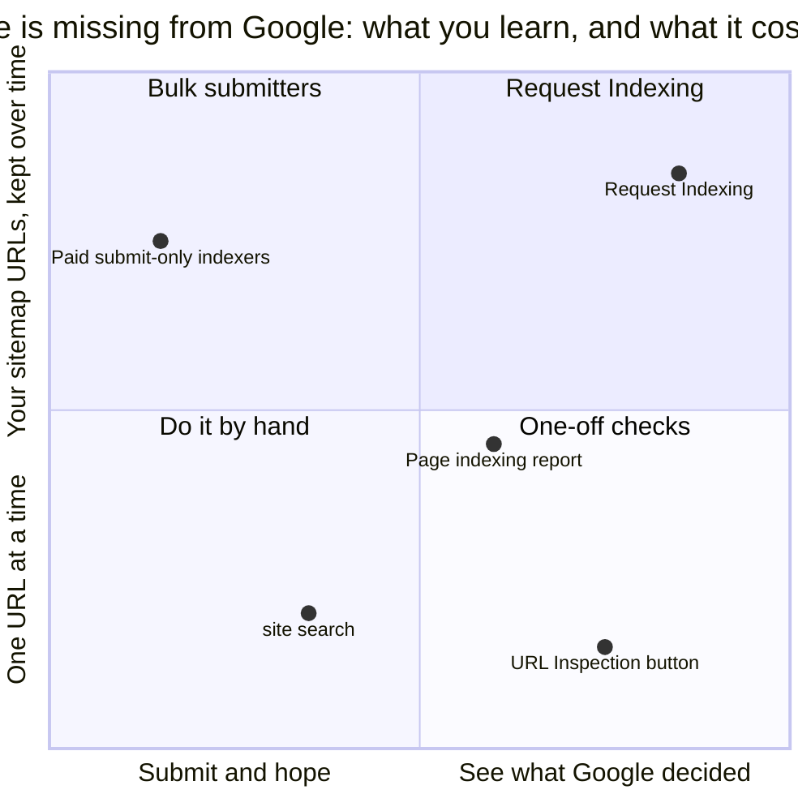

# Marketing

Godin: marketing is the generous act of helping someone make a change they already want.
It starts with the person, never the product.

**How this file uses evidence.** Narrow message, broad availability.
The message speaks to one audience (Godin, C). Anyone with a matching need must still be able to find us (Ehrenberg-Bass, B).
If a grade A finding's conditions hold, follow it. If they do not, treat the idea as a hypothesis and test it on our own data.

## Who arrives today

From [the customer evidence](docs/audits/2026-11-28-customer-evidence.md) (baseline [2026-11-17](docs/audits/2026-11-17-customer-evidence.md)):

- **They search for an action, or arrive from ChatGPT.** "request indexing" and its variants bring at least 37% of clicks. Across 28 attributed signups, 46% came from Google Search, 32% Direct, and 14% from ChatGPT (`utm:chatgpt.com`).
- **Most are outside the US.** India brings 21% of clicks, the USA 16%, then Iran, the UK, Bangladesh, and Pakistan.
- **They write about one problem.** Their pages are not indexed, a whole Site at times, and they do not know why.
- **They are individual site owners.** 91% sign in with a consumer email address (163 of 180). Of accounts with a linked Site, 80% have 1 Site. Custom-domain signups connect a Site at 47% vs 29% for consumer email.
- **About half never connect Google.** Read-only Google access (#431) raised Connect Google to 69% (9 of 13, Nov 17 to Nov 23) before dipping to 43% (3 of 7, Nov 24 to Nov 28). From Nov 22 to Nov 28, a `Provisioning` skip bug blocked 6 of 6 connected signups from adding Sites.
- **Nobody uses it as an agent door.** Across 161 linked accounts on gscdump, 0 open-signup accounts hold an agent entry, MCP call, or CLI session.
- **Search CTR is rising.** 30-day clicks reached 219 (+8%) with CTR up from 1.19% to 1.85% and mean position 10.2.

**Gap.** Return use is unmeasured, signup source covers about 5% of signups, and the first evidence view records only two opt-in paths that few users take. The Site indexing pages, where users read Google's verdict, record nothing.

## Who it is for

**The smallest viable audience is the site owner who published pages and wants them found, and who wants the reason when a page is missing.**
Most run one Site: a blog or content site, a small business, or a small app. Many write English as a second language.

**Two tiers, decided 2026-11-17.** The long tail comes in free. Multi-Site operators pay later.
- **The door:** the one-Site owner. Hand review of the Sites connected since open signup found blogs and content Sites first, then small businesses, then developer projects and small SaaS.
- **The payer:** the operator with several Sites who wants indexing to run without them. The old Pro plan sold more Sites, more indexing requests, and promised automatic indexing; over a quarter of the old waitlist paid for it, most with business email addresses.

**Worldview.** Most arrive believing indexing is a button. The ones we serve hold, or are ready to hold:
- Google decides what it indexes. A tool that promises otherwise is not telling the truth.
- A status without its reason is no answer.
- Free and open source is a reason to try something.

The worldview is the destination, not the entry test (Godin vs. Sharp, reconciled in research.md).
We meet the search where it is, then turn it.

**People like us** check what Google decided, fix the cause, and stop resubmitting and hoping.
A freelancer or small agency can give a client the reason, with its date.

**This is a bet.** It rests on search data, the funnel, and about 20 messages. The funnel shows who signs up, not why. The flip test below checks why.

**Not for.** Marketing never chases them. Saying so is a kindness, and a signal to the people it is for (Godin).

- **The guarantee buyer** who wants instant or guaranteed indexing, or a black-hat shortcut. VISION rejects both.
- **The agent operator.** gscdump serves them through MCP and the CLI. Request Indexing links there once, and its marketing never leads with agents. The dashboard Setup offers lead with IndexNow and Watched URLs, and carry no agent offer.
- **The growth team**, which nuxtseo Pro serves, and **the platform buyer** who wants rank tracking or AI visibility.

### Boundary with gscdump

gscdump owns the engine: sync, the archive, and the MCP server. Request Indexing owns the job, its screens, and its onboarding.
Site count fails as a boundary. A one-Site owner may ask Claude; an agency may want a screen.
Request Indexing is the largest source of gscdump accounts. Outside onboarding, a person who asks for an agent goes to gscdump.com.
**Onboarding leads with Agent setup, decided 2026-11-24.** The evidence in "Who arrives today" stands. The bet: many site owners already use an agent, and finish setup there. Each agent connects to gscdump's MCP server. Claude and ChatGPT reach it through gscdump's own listing and app. Request Indexing gets no listing. Connect Google stays required on every route, with no Skip.
**Reversal.** If most new accounts in a 30-day window select Skip agent setup, reverse it. If, in the same window, under half of the accounts that choose an agent finish Connect Google, reverse it too. Both readings need the agent choice recorded per signup.

## The change we seek to make

- **From** "indexing is something I do to Google" **to** "Google decides, and I can read its reason."
- **From** "I pressed the button and nothing happened" **to** "I know why this URL is out, and what to fix."
- **From** inspecting URLs one by one **to** one list of the URLs in your sitemaps, each with its verdict and what changed.

**Test:** does this piece move someone along one of these lines? If not, cut it.

## The marketing promise

> Request Indexing is for site owners who believe Google decides what it indexes, and that a status without a reason is no answer.
> It focuses on people who want the truth about their own pages, not a shortcut.
> It promises two things: every engine that takes a notice hears about your new pages, and you see what Google decided, with its reason.

Every surface is a smaller version of this promise.

**The H1 names the job: "Get your pages indexed."** Decided 2026-11-17. The copy under it says what each engine does: IndexNow notifies Bing and other participating engines; Google reads your sitemap on its own schedule, and Request Indexing shows its reason. No surface promises that Google indexes a page, and none gives a timeframe.

## Positioning

Dunford's order: alternatives, what only we have, the value, who cares most, the category (C).

| Alternative | What it leaves the person with |
|---|---|
| Search Console's URL Inspection button | One URL at a time, a daily limit per property, no record of what changed |
| Search Console's Page indexing report | Counts and samples, not every URL with its date |
| A `site:` search | An estimate, no reason |
| Paid submit-only indexers | A button, a promise nobody can keep, and nothing after the click |
| Waiting | Nothing |

- **Only here:** the URLs in your sitemaps inspected on a schedule, within your Free allowance, with each reason and change kept. IndexNow from the same dashboard. Watched URLs. Free and MIT.
- **Automatic sending, shipped in #414:** once a Site's key is verified, new and changed sitemap URLs go to IndexNow. Request Indexing turns it on at key verification. It sends the notices the old Pro plan promised as "automatic indexing". Engines still decide.
- **Delivery, fixed 2026-11-18:** every production IndexNow attempt got HTTP 429 until gscdump moved delivery to a relay. The first Submission after the fix got HTTP 202.
- **Not unique, and we say so:** the reason itself. Search Console shows it one URL at a time.
- **Value:** you learn which pages Google refused, and when that changed, without inspecting them one by one.
- **Category:** a Google indexing checker that keeps the record. "Indexing tool" implies forcing; never use it.

**Rejects:** "faster indexing" and "more data" campaigns. Each is a race on one axis. "More engines" is allowed only for engines the product notifies today.

## The tension, used honestly

The name is the question. The product is the honest answer to it.
The tension is true for every arrival: a page they published is not in Google, and nothing tells them why.
It releases when they read the reason Google gives.

**Rules:**
- **Meet the search, then turn it.** Keep the words people type in titles and the H1. Under them, say what each engine does.
- **Say the limit once per page, after the promise, as a fact about Google.** Follow it at once with what we do: "Nobody can force Google to index a page. Request Indexing shows what Google decided, and why." Two-sided messages raise trust when the limit is stated plainly and the positive follows (Eisend 2006, A).
- **Show where Google's own button is.** URL Inspection in Search Console. Pointing to a free alternative is the generous act.
- **A Submission is a notification Google accepted,** never proof of indexing.
- **The Indexing API covers job posting and livestream pages only.** Never imply a wrapper extends it.
- **No indexing timeframe, no countdown, no scarcity.**

## Category entry points

The cues that bring someone to us, ranked by the evidence. Each needs a page that answers it honestly.

| Cue | Evidence | Page that answers it | Served today |
|---|---|---|---|
| "Make Google index my page" | At least 37% of clicks | Home | Yes since #420: IndexNow and Google's reason sit under the H1 |
| "Where is Search Console's Request Indexing button?" | Position 7.4, under 1% CTR | `/request-indexing-google-search-console` | Published 2026-11-05; the home page ranks instead |
| "Is this page indexed?" | "index checker" 720 US searches a month | Free Google Index Checker | Ranks poorly |
| "Why is my page or Site not indexed?" | The clearest customer email | `/why-is-my-page-not-indexed`, `/why-is-my-site-not-indexed` | Since #438: one section per reason, no page per reason yet |
| "Can I use the Indexing API?" | 260 US searches a month | Indexing API guides | Yes |
| "Submit to Bing", "IndexNow" | One GitHub issue; Bing and other engines take IndexNow | IndexNow page, a guide, the home page | Yes: the home page names it under the H1, and `/indexnow-setup` walks through the key file (#422) |

## Forces and status

- **Push:** the page is missing, the button did nothing, and no reason appeared. **Pull:** each sitemap URL's verdict and reason in one list.
- **Anxiety:** Google access for a one-person tool, past connect failures, "will this project last?". About half of signups stop at the Google connect step. **Habit:** the Search Console button, `site:` searches, paid indexers.
- **Reduce anxiety first; it costs least.** Name the access we ask for, show the source, and say who builds it.
- **Status is affiliation, not dominance.** The person wants to be the one who knows what happened and was not fooled by a trick.

**Rejects:** "beat your competitors", "rank #1", "instant indexing", and growth-hack copy.

## Permission and trust, earned in this order

1. **Free tools first.** A verdict with no signup. The first interaction is a gift.
2. **Guides that tell the truth,** in plain words a second-language reader can follow.
3. **The record keeps its promise.** A wrong or stale reason breaks trust faster than any page builds it.
4. **Email with one useful step.** Each onboarding email stands alone with one action. No email exists only to remind.

**Trust comes from what a skeptic can check:** the MIT source, the truth rules in COPY.md, and claims that name their evidence.

## Pricing is a story

- **Free, with a Free allowance** says: try it on your own Sites with no sales call.
- **gscdump sets the allowance.** Marketing never hardcodes a number.
- **Paid usage comes later,** under this brand. Marketing never quotes a price before one exists.

## Channels, ranked

*This Is Strategy*: choose the game, then let the system work. Our game is to be the honest answer to the indexing question, wherever someone asks it.

| Channel | Impact /100 | Grade | Status | Move |
|---|---|---|---|---|
| The "request indexing" search, home page | 70 | B | Proven, CTR rising (1.85%) | Keep the words, change the promise |
| ChatGPT referrals (`utm_source=chatgpt.com`) | 65 | B | 14% of attributed signups (#2 external source) | Keep guides and home copy clear for AI citation |
| How-to pages for queries at positions 7 to 12 | 65 | B | Pages exist, win few clicks | Rewrite the Search Console guide first |
| One guide per Google reason | 60 | B/C | No pages | Write the whole-Site case first |
| IndexNow on the home page and in a setup guide | 55 | C | Product ships it; delivery works since 2026-11-18 | Name it under the H1 and write the key file guide |
| Free Google Index Checker | 50 | B | Ranks poorly | Improve rank on one tool |
| Help communities where owners ask "why not indexed" | 45 | C | Unused | Answer generously, Harlan's name, disclosed |
| nuxtseo.com, gscdump.com, Harlan's channels | 40 | C | Family links exist | Developers spread it; they are not the audience |
| Agent directories and MCP | 0 | B | No account holds an API key | gscdump's shelf, not ours |

**Rejects:** paid ads before people return, cold outreach, "instant indexing" listicles, link schemes, and any forum that sells indexing tricks.

## The metric

**The share of signups in a 30-day window that connect a Site.** Read it in `/admin/funnel` (`docs/runbooks/signup-funnel.md`).

- Baseline: 28%, 2026-10-19 to 2026-11-17.
- Target: 40% for the window ending 2027-01-16. Most of the loss is at the Google connect step, where anxiety is cheapest to move.
- Next metric: the first view of Google's evidence for one of their own pages. Checked 2026-11-19: the event records, but only on two opt-in paths that few users take. Record views on the Site indexing pages first, then switch.

## Flip test

Ask the accounts that connected Google in the last 90 days one question, except addresses that opted out of Product updates: "What did you come to Request Indexing to do?" Draft in `docs/marketing/channel-kit.md`.

| Result | Move |
|---|---|
| Most want to force indexing and never open a reason | Move the door to diagnosis guides; stop investing in the home page promise |
| Most write code or ask for agents | Fold the audience into gscdump's developer funnel |
| Otherwise | This file stands |

## The review gate

Before any page, post, launch, or email ships, answer each question in one line:

1. **Who is it for?** Name the audience from this file.
2. **What change does it move?** Name the line from "The change we seek to make".
3. **Does it fit the promise?** It never promises that Google indexes a page, and gives no timeframe.
4. **Is the tension true?** Point to VISION.md or the truth rules in COPY.md.
5. **What is the one action?** Exactly one, and it happens inside Request Indexing.

If any answer is blank, it does not ship.

## Voice

Founder-led. Harlan writes in first person on his own channels and in the onboarding emails: plain, specific, a little dry.
Write for a reader with English as a second language: short sentences, common words, no idioms.
Product surfaces follow the registers in COPY.md. Every claim names its number or its source.

**Rejects:** a faceless brand voice, superlatives, and any claim without its evidence.

## Open questions

Resolve one, fold it in above, then delete it here.

1. **Agent-first onboarding reversal gate.** `agent_setup_selected` and `agent_setup_skipped` now record in `pro_events` and `/admin/funnel`. Evaluate after 30 days against the reversal rule above.
2. **IndexNow verification drop.** 6 of 7 Request Indexing accounts that started IndexNow never verified (4 failed with `key-file-unavailable`), and 0 enabled automatic sending. Inspect where key-file setup stalls.
3. **The paid tier for operators.** What it costs, and when. Marketing quotes no price until one exists.
4. **About you role labels.** Add `Site or business owner` alongside `Solo developer` across `@nuxtseo/design-system`, `gscdump.com`, `requestindexing.com`, and `nuxtseo.com` together.
