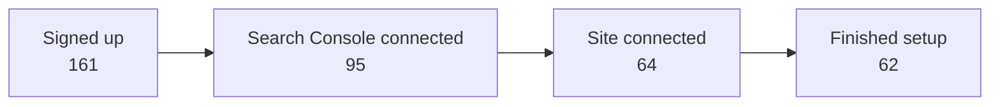

# Customer evidence, 2026-11-17

This snapshot answers one question: who uses Request Indexing today, and how did they arrive?
It feeds the audience and channel sections of MARKETING.md.
Figures are status. They rot. Rerun the appendix queries before you reuse one.
The method mirrors the gscdump.com snapshot of the same date (harlan-zw/gscdump.com#1210).

---

## Summary

1. **Search clicks come from the product name.** Product name queries bring 161 of 232 query row clicks in 89 days. Signup source is known for 11 signups only: 4 came from a search engine and 3 from ChatGPT.
2. **Signups arrive at a steady rate, with no launch spike.** Open signup started on 2026-09-16 (#119). Full weeks since then had 17 to 24 signups, until 9 in the week from 2026-11-09.
3. **Most users are site owners, not developers.** Of 54 accounts with a linked Site, about 16 run blogs or content sites and 15 run small businesses. About 6 run developer projects or apps. 47 of 54 sign in with a consumer email address.
4. **One Site, in one sitting.** 44 of 54 accounts connect 1 Site. 76 of 77 Site funnel milestones came within 1 hour of signup.
5. **Fewer new accounts record a Site milestone.** 25 of 45 signups in the weeks from 2026-10-05 and 2026-10-12 recorded one. From 2026-10-19, 19 of 67 did. The cause is not known.
6. **The earlier account base is dormant.** 2,645 accounts existed before open signup. 55 of them have connected Search Console since 2026-08-11.
7. **Return use and motive are not recorded.** No local record shows a return visit. The About you card has 0 answers.

---

## Accounts by period and source

`users.source` is empty for every account, so the period of creation is the only source signal before 2026-11-10.

| Period | Accounts | Hold a Site today | Search Console connected since 2026-08-11 |
|---|---|---|---|
| Imported, one shared timestamp: 2026-04-22 15:13:53 UTC | 2,224 | 757 | 20 |
| Created 2026-04-22 to 2026-09-15, before open signup (#119) | 421 | 5 | 35 |
| Open signup, from 2026-09-16 | 161 | 74 | 95 |

Total accounts, founder excluded: 2,806.
150 accounts hold a gscdump identity. The gscdump.com snapshot counts 149 accounts whose Google tokens Request Indexing issued.

**Weekly signups**, Monday weeks, open signup:
2026-09-14 (partial, from Wednesday): 13, 09-21: 19, 09-28: 17, 10-05: 21, 10-12: 24, 10-19: 17, 10-26: 19, 11-02: 17, 11-09: 9, 11-16 (partial, 2 days): 5.

Before open signup, 13 to 30 accounts arrived each week from 2026-04-27 to 2026-09-07.
Only 5 of those 421 accounts hold a Site today.

### Signup attribution

Capture started on 2026-11-10 (#382). It covers all 11 signups since then.

| Source | Signups |
|---|---|
| Direct: no referrer and no campaign | 4 |
| ChatGPT (`utm_source=chatgpt.com`) | 3 |
| Google Search | 2 |
| Bing | 1 |
| DuckDuckGo | 1 |

- Landing route group: `/` 7, `/tools` 2, `/pro/onboarding` 2.
- No captured signup came from nuxtseo.com, gscdump.com, GitHub, or a social site.

## Signup funnel

Open signup accounts, founder excluded, funnel milestones as `/admin/funnel` reads them. Each step requires the earlier milestones.



- 102 accounts finished setup in total. 40 of them lack a Search Console or a Site milestone.
- Today 54 accounts hold a Site linked to gscdump. 47 hold a Site whose mirrored sync status is `synced`. The mirror is a cache.
- 76 of 77 Site milestones and 94 of 95 Search Console milestones came within 1 hour of signup. 90 of 91 Sites were connected within 1 day of signup.
- 24 Sites have no gscdump link. 23 of them were connected in September by 20 accounts that hold no linked Site. Some are domains the account cannot own. The other is 1 `refused` Site from October.

The weekly table counts each milestone on its own, without the earlier steps.

| Signup weeks | Signups | Search Console milestone | Site milestone |
|---|---|---|---|
| 2026-09-14 to 2026-09-28 | 49 | 23 | 33 |
| 2026-10-05 to 2026-10-12 | 45 | 37 | 25 |
| 2026-10-19 to 2026-11-16 | 67 | 35 | 19 |

**Reading:** people connect a Site at signup. Almost nobody connects one later. From 2026-10-19, fewer than a third of new accounts record a Site milestone.

## Usage after setup

What D1 records after the first session:

- **Return visits:** not recorded. `users.last_login` is written only when the account is created. `sessions` stops at 2026-08-10.
- **Google evidence views** (`page_evidence_viewed`, `first_report_evidence_viewed`): 0 rows. #376 merged on 2026-11-07, and 21 accounts signed up since then. The deploy date is not recorded here. 2 accounts started a page task (`page_task_started`).
- **Investigations:** 0 rows. **Feedback reports:** 0 rows.
- **Product updates:** 90 accounts entered the onboarding emails. 7 addresses opted out.
- **Agents:** the gscdump.com snapshot counts 48 MCP accounts on 2026-11-17. 1 came through Request Indexing. This repo emits no `first_mcp_tool_call` milestone.

### Free tools

`dataforseo_requests`, 2026-08-26 to 2026-11-16. Each row is one provider call, and a bulk check writes many.

- 796 calls from 176 distinct IP hashes.
- 175 of 176 IP hashes used a tool on one day only.
- Distinct IP hashes per week from 2026-10-05: 27, 78, 10, 20, 15, 15.
- The bulk check made 599 calls from 32 IP hashes.

**Reading:** most free tool visitors use a tool on one day only.

## Who the users are

54 open signup accounts with a linked Site, founder excluded, classified by hand from Site hostnames. Hostnames stay in production.

| Kind of Site | Accounts, approx. |
|---|---|
| Blogs and content sites: education, news, reviews, affiliate | 16 |
| Small businesses: local services, stores, clinics, property, construction | 15 |
| Developer projects, apps, and small SaaS | 6 |
| Gaming communities and personal sites | 3 |
| Download, streaming, and betting sites | 3 |
| SEO services | 1 |
| Unclear | 10 |

- 47 of 54 sign in with a consumer email address.
- 44 connect 1 Site, 7 connect 2, and 3 connect 3.
- 8 of 54 connect only Sites on free hosting subdomains, such as Blogger or GitHub Pages.
- Many Sites serve markets outside the US and UK. By domain and language, South Asia is the largest group.
- Of 67 linked Sites, 56 show `synced` and 8 show `error` in the mirror.

**About you:** #384 merged on 2026-11-10. The card shows on the sync step. Since that date, 11 accounts signed up and 1 recorded a Site milestone. 1 card closed with every field empty. There are 0 answers to report.

**Limit:** a hostname shows the kind of Site, not the person's role or goal. Ask the accounts with a synced Site before you treat the table as a persona.

## Search demand for requestindexing.com

Search Console through the gscdump CLI in Hosted mode, 2026-08-19 to 2026-11-15 (89 days):
535 clicks and 53,298 impressions by date. The query rows sum to 232 clicks and 38,114 impressions across 952 queries, because Google omits anonymized queries.
Search Console lists only queries the site already appears for.

| Query cluster | Queries | Clicks | Impressions | Mean position |
|---|---|---|---|---|
| "Request indexing", the product name, and variants | 149 | 161 | 10,491 | 6.8 |
| Submit a page, or get it indexed | 353 | 28 | 19,174 | 16.7 |
| Google Indexing API | 58 | 22 | 2,816 | 16.8 |
| Search Console and URL Inspection | 83 | 0 | 1,943 | 24.2 |
| Indexing tool, checker, or service | 108 | 15 | 1,533 | 21.3 |
| Fast, instant, or bulk indexing | 64 | 4 | 1,183 | 18.4 |
| Other | 137 | 2 | 974 | 24.3 |

- "request indexing" alone: 57 clicks at mean position 3.5.
- Queries that ask whether a page is indexed, or why not: 32 queries, 199 impressions, 0 clicks.
- Pages, by the page dimension: the home page takes 488 of 563 clicks. The seven guides take 50 clicks and 7,496 impressions, mostly on the two Indexing API guides. `/tools` pages take 10 clicks. Comparisons take 7.
- Impressions per ISO week: 5,185 to 6,921 from 2026-08-24 to 2026-09-20, then 2,313 to 2,560 from 2026-10-26 to 2026-11-15.
- Clicks per week held at 35 to 58 from 2026-09-14 to 2026-11-08. The week from 2026-11-09 had 31.
- In the seven full weeks from 2026-09-21 to 2026-11-08, Search brought 330 clicks and 134 accounts signed up. That is 1 signup for every 2.5 Search clicks, a high rate if Search were the only source.

**Reading:** most query clicks come from the product name. Searchers who find it use submission words. The site gets few impressions for status or reason words.

## Open-source repository

- `harlan-zw/requestindexing.com`: 401 stars and 34 forks on 2026-11-17. Stars accumulate over the whole life of the repository, including the earlier product.

## What this snapshot cannot tell

- **Return use.** No local table records a visit after signup. Dashboard reads go to gscdump.
- **Why people sign up.** The About you card has 0 answers.
- **Where most signups came from.** Attribution covers 11 signups.
- **Guide landings.** Attribution groups landing pages into `/`, `/tools`, `/guides`, and app routes. Guides are served at root paths and comparisons under `/comparisons`. A signup that starts there records the next grouped page instead, and a full page load on the way also drops the external referrer.
- **The developer path.** API keys, MCP calls, and CLI sessions live in gscdump. This app keeps no record of them.
- **Free tools to signup.** IP hashes are not linked to accounts.
- **Original signup dates** of the 2,224 imported accounts. They share one import timestamp.
- **Founder test accounts.** The filter excludes harlanzw.com addresses only. One open signup account lists this product's own domain among its unlinked Sites.

## What this means for MARKETING.md

Each line quotes MARKETING.md, then states the evidence. This section makes no decision.

- > "**The smallest viable audience is the indie developer whose new page is missing from Google.**"

  **Contradicts, by kind of Site.** About 6 of 54 accounts with a linked Site run developer projects or apps. About 31 run content sites or small businesses. 10 are unclear. 47 of 54 use a consumer email address.

- > "They typed "request indexing" into Google."

  **Supports, for Search clicks.** Product name queries bring 161 of 232 query row clicks. Signup source is known for 11 signups only, and 4 of them came from a search engine.

- > "In practice: indie devs, small agencies, and operators running a handful of Sites who do not want another dashboard with a query builder in it."

  **Mixed.** 44 of 54 accounts connect 1 Site. 1 runs an SEO service. The view on dashboards is not measured.

- > "The audience seeks affiliation: being a developer who ships and does it properly, with tools they can check."

  **Contradicts, by kind of Site.** Most linked accounts are not developer projects. 0 of 11 captured signups came from nuxtseo.com, gscdump.com, or GitHub.

- > "**The agent operator.** gscdump serves them directly, through MCP. Request Indexing never leads with agents."

  **Supports.** 1 of 48 gscdump MCP accounts came through Request Indexing (gscdump.com snapshot, 2026-11-17).

- > "**The guarantee buyer** who wants guaranteed or instant indexing, or a black-hat shortcut. VISION rejects both."

  **Supports, on query figures alone.** Fast, instant, or bulk queries bring 1,183 impressions and 4 clicks. What a signup wants is not measured.

- > "Search for "request indexing" and its questions | The audience types the product name when they need it"

  **Supports, for Search traffic.** 535 Search clicks in 89 days. The home page takes 488 of 563 page clicks. Weekly impressions fell by more than half from September to November. Signup source is known for 11 signups only.

- > "Free `/tools` pages | An answer before signup"

  **Mixed.** 176 IP hashes used a tool, and 175 of them on one day only. 2 of 11 captured signups landed on `/tools`.

- > "Guides and comparisons | Trust, earned by saying what the API cannot do"

  **Not measured as a signup source.** The guides take 50 Search clicks and the comparisons 7. Attribution cannot see a guide landing.

- > "Harlan's channels | A maintainer the audience already follows"

  **Not measured.** 0 of 11 captured signups came from a social site.

- > "The open-source repository | The code is the evidence"

  **Not measured.** The repository has 401 stars. 0 of 11 captured signups came from GitHub.

- > "nuxtseo.com and gscdump.com | People already in the family, sent where their job fits"

  **Not measured.** 0 of 11 captured signups came from either site.

- ChatGPT is not in the channel table. 3 of 11 captured signups came from it.

- > "1. **Free tools first.** The `/tools` pages check index status with no signup. The first interaction is a gift."

  **Mixed.** See the `/tools` row above.

- > "1. **Submission for ordinary pages.** [...] Decide whether marketing leads with Submission, or with the record."

  **No verdict: this is an open question.** Submission words bring 29,665 impressions across the product name and submit clusters. Status or reason words bring 199. The About you goals question has 0 answers.

---

## Appendix: queries

Run against `request-indexin-bw2z` with `pnpm exec wrangler d1 execute request-indexin-bw2z --remote --json --command "<sql>"`. Read only.
`cf d1 query <database_id from wrangler.toml> --sql "<sql>"` runs the same SQL.
`pro_events.created_at` is in milliseconds. `users.created_at` and `sites.created_at` are UTC text. `dataforseo_requests.created_at` is in seconds.

```sql
-- Accounts by period, founder excluded
SELECT CASE WHEN u.created_at < '2026-04-22 15:14' THEN 'imported'
  WHEN u.created_at < '2026-09-16 06:07' THEN 'before open signup' ELSE 'open signup' END period,
  COUNT(*) accounts,
  SUM(EXISTS(SELECT 1 FROM sites s WHERE s.team_id = u.current_team_id)) with_site,
  SUM(EXISTS(SELECT 1 FROM pro_events e WHERE e.user_id = u.user_id AND e.type = 'gsc_connected')) gsc_connected
FROM users u WHERE u.email NOT LIKE '%@harlanzw.com' GROUP BY 1;

-- Weekly signups, Monday weeks
SELECT date(p.created_at / 1000, 'unixepoch', '-6 days', 'weekday 1') week, COUNT(*) signups
FROM pro_events p JOIN users u USING (user_id)
WHERE p.type = 'signed_up' AND u.email NOT LIKE '%@harlanzw.com' GROUP BY 1 ORDER BY 1;

-- Signup attribution
SELECT json_extract(p.payload, '$.attributionSource') source,
  json_extract(p.payload, '$.landingPath') landing, COUNT(*) signups
FROM pro_events p JOIN users u USING (user_id)
WHERE p.type = 'signed_up' AND u.email NOT LIKE '%@harlanzw.com'
  AND json_extract(p.payload, '$.attributionBasis') IS NOT NULL
GROUP BY 1, 2;

-- Signup funnel: each step requires the earlier milestones
WITH c AS (
  SELECT u.user_id, u.onboarding_completed_at oc FROM users u
  JOIN pro_events s ON s.user_id = u.user_id AND s.type = 'signed_up'
  WHERE u.email NOT LIKE '%@harlanzw.com'),
f AS (
  SELECT c.*,
    EXISTS(SELECT 1 FROM pro_events e WHERE e.user_id = c.user_id AND e.type = 'gsc_connected') g,
    EXISTS(SELECT 1 FROM pro_events e WHERE e.user_id = c.user_id AND e.type = 'site_added') s
  FROM c)
SELECT COUNT(*) signed_up, SUM(g) gsc, SUM(g AND s) site, SUM(g AND s AND oc IS NOT NULL) finished,
  SUM(oc IS NOT NULL) finished_any
FROM f;

-- Time from signup to each funnel milestone
SELECT e.type, CASE WHEN e.created_at - s.created_at < 3600000 THEN 'under 1 hour' ELSE '1 hour or more' END gap,
  COUNT(*) accounts
FROM pro_events s JOIN pro_events e ON e.user_id = s.user_id AND e.type IN ('gsc_connected', 'site_added')
JOIN users u ON u.user_id = s.user_id
WHERE s.type = 'signed_up' AND u.email NOT LIKE '%@harlanzw.com' GROUP BY 1, 2;

-- Milestones by signup week, each counted on its own
SELECT date(s.created_at / 1000, 'unixepoch', '-6 days', 'weekday 1') week, COUNT(*) signups,
  SUM(EXISTS(SELECT 1 FROM pro_events e WHERE e.user_id = s.user_id AND e.type = 'gsc_connected')) gsc,
  SUM(EXISTS(SELECT 1 FROM pro_events e WHERE e.user_id = s.user_id AND e.type = 'site_added')) site
FROM pro_events s JOIN users u ON u.user_id = s.user_id
WHERE s.type = 'signed_up' AND u.email NOT LIKE '%@harlanzw.com' GROUP BY 1 ORDER BY 1;

-- Linked Sites per open signup account
WITH c AS (
  SELECT u.current_team_id tid FROM users u
  JOIN pro_events s ON s.user_id = u.user_id AND s.type = 'signed_up'
  WHERE u.email NOT LIKE '%@harlanzw.com')
SELECT n sites, COUNT(*) accounts FROM (
  SELECT COUNT(*) n FROM c JOIN sites x ON x.team_id = c.tid AND x.gscdump_site_id IS NOT NULL
  GROUP BY c.tid)
GROUP BY 1;

-- Free tools
SELECT COUNT(*) calls, COUNT(DISTINCT ip_hash) ip_hashes FROM dataforseo_requests;

-- About you
SELECT COUNT(*) closed, SUM(onboarding_answers IS NOT NULL) stored
FROM users WHERE onboarding_answers_closed_at IS NOT NULL AND email NOT LIKE '%@harlanzw.com';
```

The kind of Site table reads `group_concat(sites.domain)` per account on screen. Never paste that output.

Search demand: `gscdump query -s requestindexing.com -d date --start 2026-08-19 --end 2026-11-15 -f json -q`, then the same with `-d query` and `-d page`.
